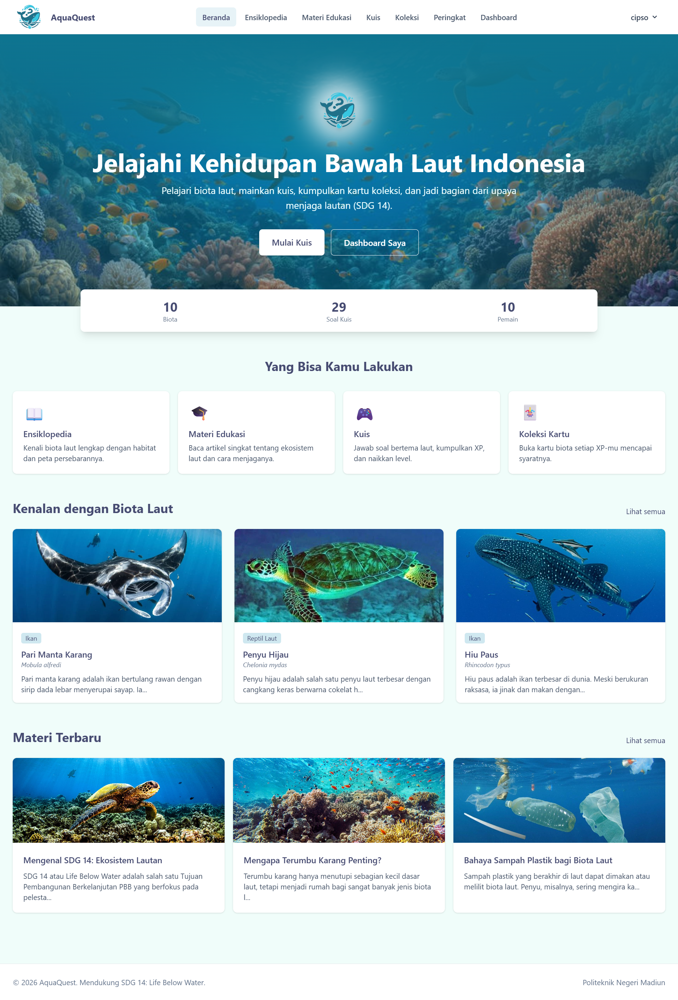
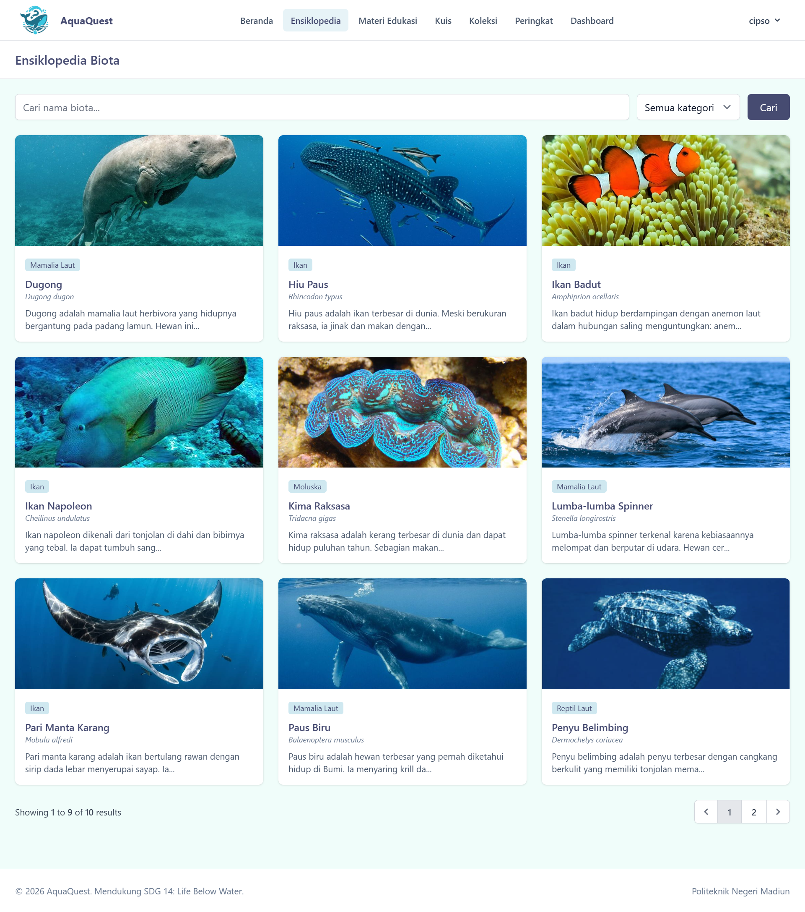
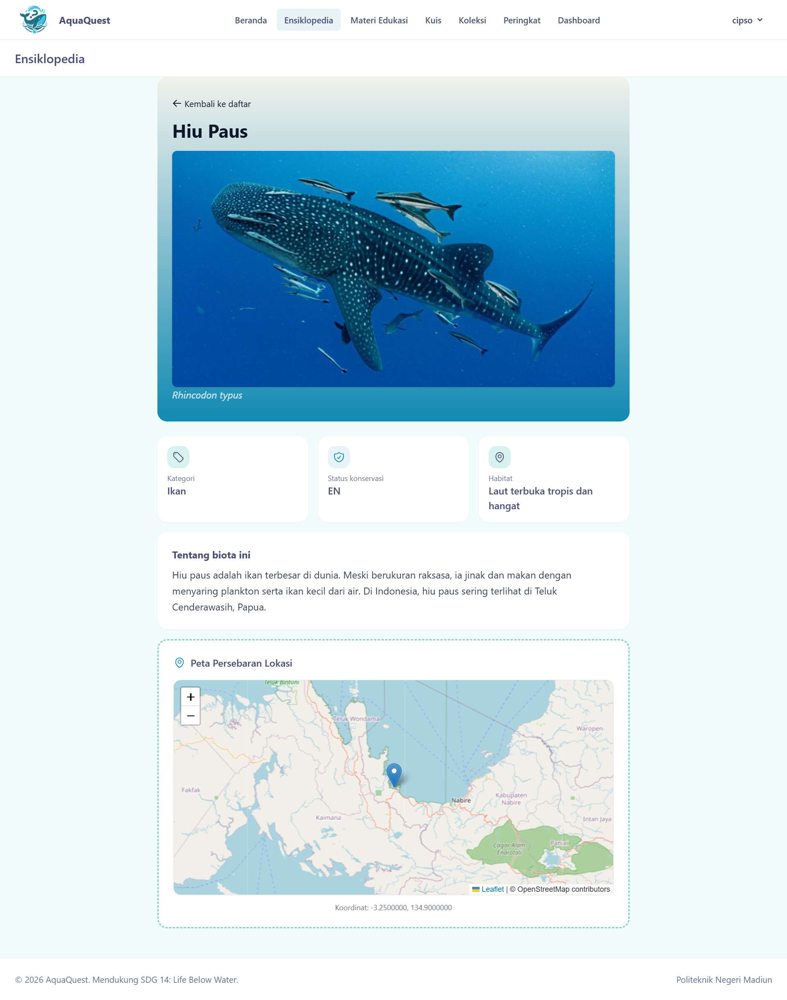
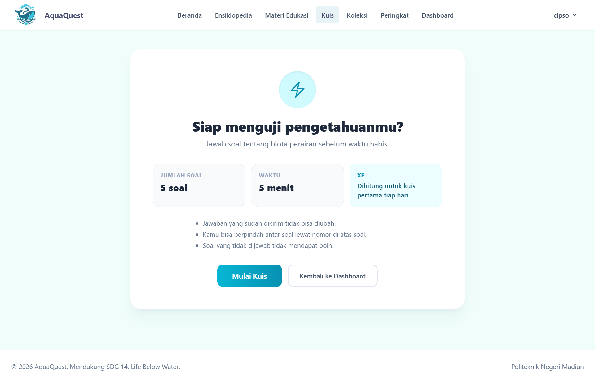
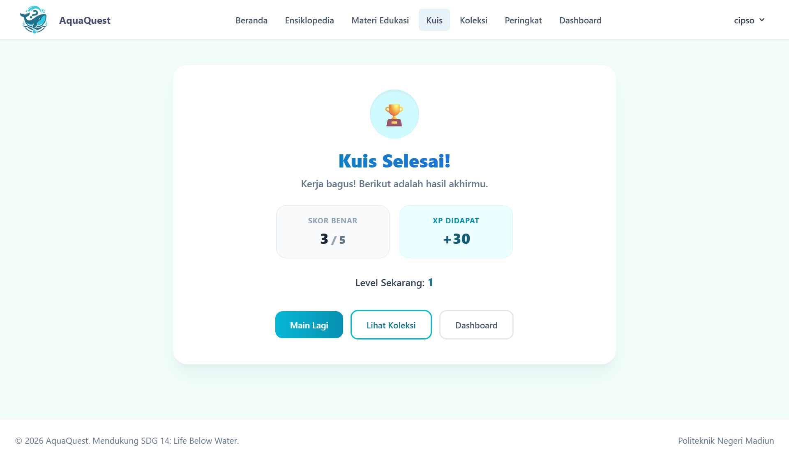
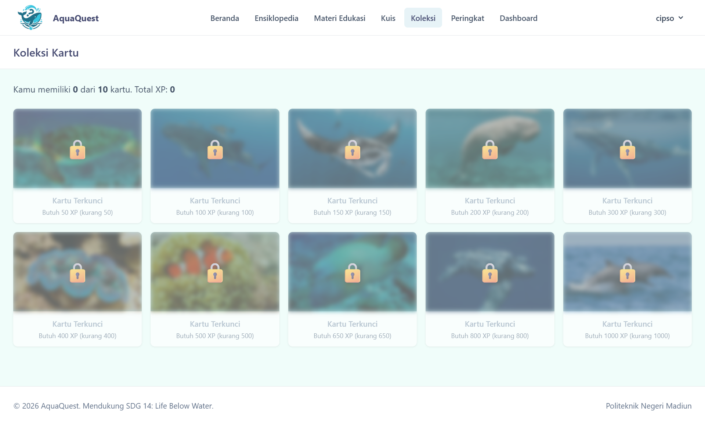
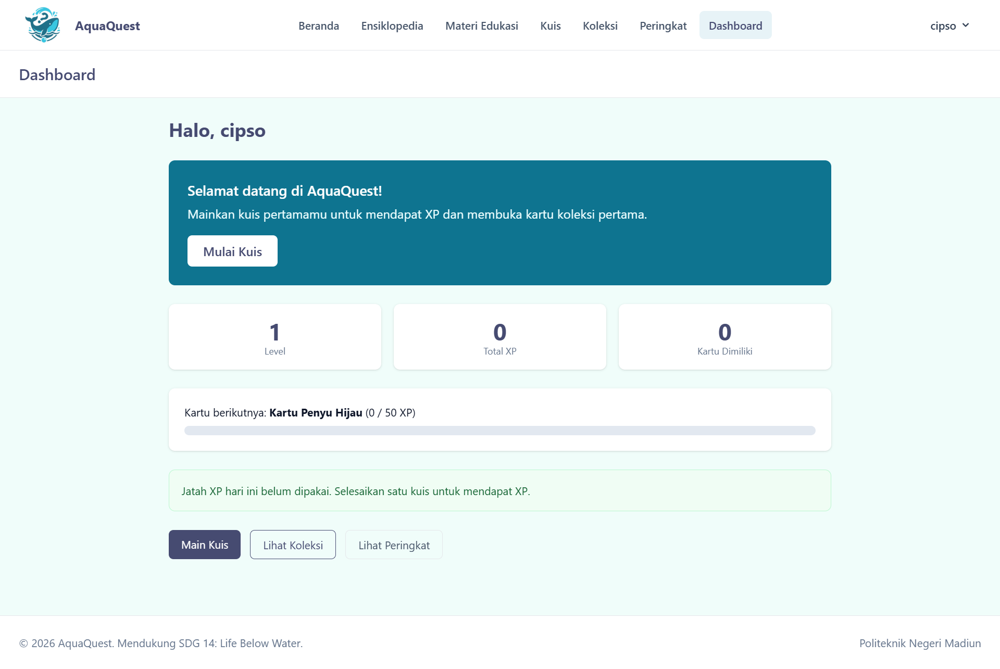
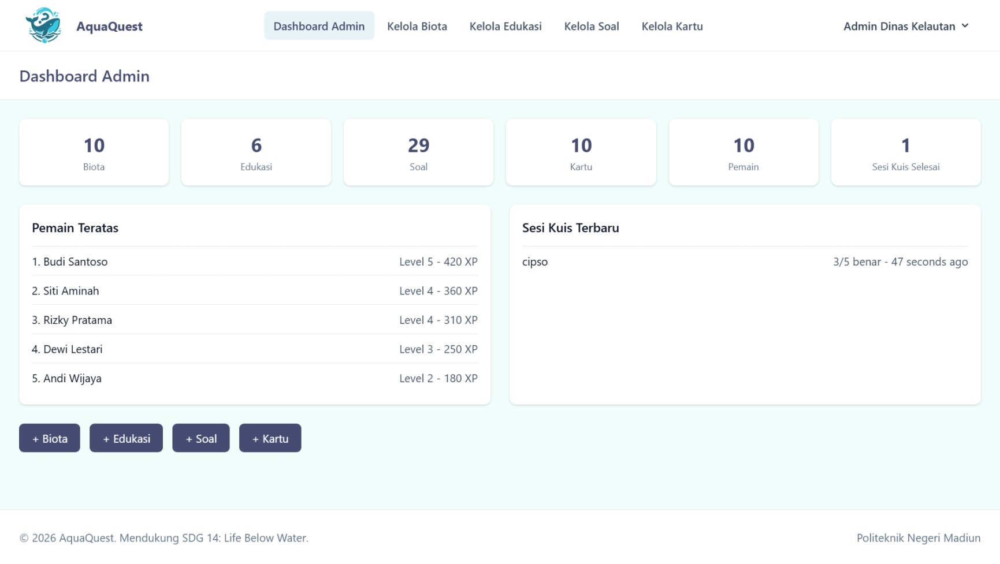
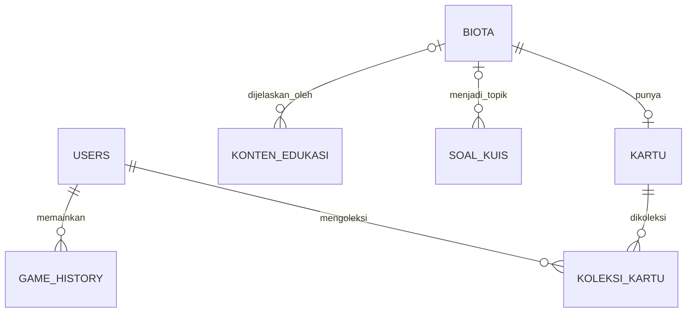

# AquaQuest 🌊

[](https://laravel.com)
[](https://www.php.net)
[](https://www.mysql.com)
[](https://tailwindcss.com)
[](#pengujian)

**AquaQuest** adalah aplikasi web edukasi interaktif berbasis gamifikasi untuk mengenalkan biota air Indonesia.
Pengguna belajar lewat ensiklopedia dan materi edukasi, bermain kuis, mengumpulkan XP, naik level, dan membuka
kartu koleksi. Dinas terkait mengelola seluruh konten lewat panel admin. Proyek ini mendukung **SDG 14: Life Below Water**.

> Proyek tugas akhir mata kuliah. Politeknik Negeri Madiun, Program Studi Teknologi Rekayasa Perangkat Lunak, Kelas 2A.

## Daftar isi

1. [Tangkapan layar](#tangkapan-layar)
2. [Latar belakang dan tujuan](#latar-belakang-dan-tujuan)
3. [Fitur](#fitur)
4. [Aturan permainan](#aturan-permainan)
5. [Teknologi](#teknologi)
6. [Arsitektur dan struktur folder](#arsitektur-dan-struktur-folder)
7. [Menjalankan secara lokal](#menjalankan-secara-lokal)
8. [Akun demo](#akun-demo)
9. [Peta halaman (route)](#peta-halaman-route)
10. [Basis data](#basis-data)
11. [Keamanan dan integritas kuis](#keamanan-dan-integritas-kuis)
12. [Pengujian](#pengujian)
13. [Git Flow dan kolaborasi](#git-flow-dan-kolaborasi)
14. [Rilis dan mode demo](#rilis-dan-mode-demo)
15. [Pemecahan masalah (FAQ)](#pemecahan-masalah-faq)
16. [Keterbatasan dan pengembangan lanjutan](#keterbatasan-dan-pengembangan-lanjutan)
17. [Tim dan tanggung jawab](#tim-dan-tanggung-jawab)
18. [Kredit dan lisensi](#kredit-dan-lisensi)

## Tangkapan layar

|                                                    |                                                          |
| -------------------------------------------------- | -------------------------------------------------------- |
|            |        |
| Beranda                                            | Ensiklopedia dengan pencarian dan filter                 |
|  |                        |
| Detail biota dengan peta lokasi                    | Kuis dengan timer                                        |
|      |            |
| Hasil kuis: XP, level, kartu baru                  | Koleksi kartu                                            |
|   |  |
| Dashboard pengguna                                 | Dashboard admin                                          |

## Latar belakang dan tujuan

Pengetahuan masyarakat tentang keanekaragaman biota laut dan pentingnya menjaganya masih terbatas, sementara materi
edukasi yang ada cenderung statis. AquaQuest menggabungkan konten edukasi yang terkurasi dengan unsur permainan
(kuis, XP, level, kartu koleksi, peringkat) agar belajar terasa menarik, dan memberi dinas terkait alat untuk
memperbarui konten tanpa menyentuh kode.

**Pengguna sasaran:** masyarakat umum (pelajar hingga dewasa) dan dinas terkait sebagai pengelola konten.

**Hubungan dengan SKPL:** SKPL menjadi referensi pendukung. Karena waktu pengerjaan dua minggu, beberapa keputusan
teknis berbeda dari SKPL (misalnya memakai Laravel monolith, bukan API terpisah). Seluruh penyimpangan beserta
alasannya dicatat di [docs/DECISIONS.md](docs/DECISIONS.md).

## Fitur

**Pengguna (masyarakat)**

- Daftar, masuk, keluar, dan ubah profil
- Ensiklopedia biota dengan pencarian nama dan filter kategori
- Detail biota: deskripsi, habitat, status konservasi (IUCN), dan peta lokasi (Leaflet + OpenStreetMap)
- Materi edukasi dengan pencarian
- Kuis pilihan ganda hybrid (soal teks dan tebak gambar) dengan hitung mundur
- XP, level, dan kartu koleksi virtual yang terbuka otomatis
- Peringkat Top XP dan dashboard progres (level, XP, kartu berikutnya, status jatah XP harian)

**Admin (dinas terkait)**

- Dashboard ringkasan: jumlah data, pemain teratas, sesi kuis terbaru
- CRUD biota, konten edukasi, bank soal kuis, dan kartu, termasuk unggah gambar
- Halaman admin hanya dapat diakses akun dengan peran `admin`

**Umum**

- Navbar menyesuaikan kondisi tamu, user, dan admin; tampilan responsif (mobile dan desktop)
- Antarmuka dan pesan validasi berbahasa Indonesia
- Halaman error khusus (403, 404, 419, 429, 500, 503)

## Aturan permainan

| Aturan           | Nilai                                                                                           |
| ---------------- | ----------------------------------------------------------------------------------------------- |
| Soal per sesi    | 5 soal acak                                                                                     |
| Batas waktu sesi | 5 menit                                                                                         |
| XP per sesi      | Jumlah poin soal yang dijawab benar (bawaan 10 poin per soal)                                   |
| Batas XP harian  | Hanya **sesi pertama yang selesai setiap hari** yang menambah XP; sesi berikutnya hanya latihan |
| Rumus level      | `level = floor(total_xp / 100) + 1`                                                             |
| Kartu koleksi    | Terbuka otomatis saat total XP mencapai syarat XP kartu                                         |
| Zona waktu       | `Asia/Jakarta` (hari berganti pukul 00.00 WIB)                                                  |

## Teknologi

| Lapisan     | Teknologi                                                                                |
| ----------- | ---------------------------------------------------------------------------------------- |
| Backend     | PHP 8.3, Laravel 12 (monolith, Blade)                                                    |
| Autentikasi | Laravel Breeze (Blade)                                                                   |
| Frontend    | Blade, Tailwind CSS, Alpine.js (dibangun dengan Vite); komponen berpedoman pada Flowbite |
| Basis data  | MySQL 8                                                                                  |
| Peta        | Leaflet.js + OpenStreetMap                                                               |
| Pengujian   | Pest, Laravel Pint                                                                       |

**Mengapa Laravel monolith?** Satu codebase mempercepat integrasi backend dan frontend untuk tenggat dua minggu.
Logika bisnis tetap dipisah rapi di kelas _service_ sehingga mudah diuji. Alasan lengkap ada di
[docs/DECISIONS.md](docs/DECISIONS.md).

## Arsitektur dan struktur folder

```
Browser (Blade + Tailwind + Alpine.js, Leaflet)
        |  HTTP (halaman) / JSON (kuis)
Routes -> Middleware (auth, role, throttle) -> Controller (tipis)
        |
Service (KuisService, LevelService, KartuService, GambarService, SlugService)
        |
Model Eloquent  ->  MySQL
```

```
app/
  Http/Controllers/        controller publik dan Auth (Breeze)
  Http/Controllers/Admin/  controller panel admin
  Http/Middleware/         EnsureUserHasRole
  Models/                  model Eloquent (+ Concerns/HasGambarUrl)
  Services/                logika bisnis (kuis, XP, level, kartu, gambar, slug)
database/
  migrations/              skema basis data
  seeders/                 data riil + images/ (gambar bawaan)
  factories/               pabrik data untuk pengujian
resources/views/           Blade: layouts, components, halaman publik, admin, auth, errors
routes/                    web.php (publik dan user), admin.php (khusus admin)
tests/Feature/             pengujian Pest
docs/                      dokumentasi pendukung
```

## Menjalankan secara lokal

**Prasyarat:** PHP 8.3 (ekstensi mbstring, xml, curl, mysql, gd, intl, zip), Composer 2, Node 22, MySQL 8, Git.

```bash
git clone <https://github.com/Bangkitcahyalinuwih/aquaquest.git>
cd aquaquest

composer install
cp .env.example .env
php artisan key:generate
```

Buat basis data kosong bernama `aquaquest` (charset `utf8mb4`), lalu sesuaikan `DB_USERNAME` dan `DB_PASSWORD` di `.env`.

```bash
php artisan migrate:fresh --seed     # membuat tabel dan mengisi data riil
php artisan storage:link             # Windows: jalankan terminal sebagai Administrator
npm ci
npm run build                        # atau `npm run dev` saat pengembangan
php artisan serve
```

Buka `http://127.0.0.1:8000`.

**Catatan lintas sistem operasi**

- **Linux:** boleh memakai `composer dev` untuk menjalankan server dan Vite sekaligus.
- **Windows/Laragon:** jalankan `php artisan serve` dan `npm run dev` di dua terminal terpisah (jangan `composer dev`).
- Nama berkas Blade dan gambar memakai huruf kecil (Linux membedakan huruf besar/kecil).
- Setiap kali ada perubahan skema di repo, jalankan `git pull`, lalu `php artisan migrate:fresh --seed` karena basis data
  tiap laptop terpisah.

## Akun demo

Khusus lokal dan demo. Seluruh kata sandi: `password`. Ganti bila aplikasi dipasang di luar lingkungan demo.

| Peran         | Email                                                  | Keterangan                                                        |
| ------------- | ------------------------------------------------------ | ----------------------------------------------------------------- |
| Admin         | `admin@aquaquest.test`                                 | Akses panel admin                                                 |
| Pengguna demo | `demo@aquaquest.test`                                  | XP awal 80; satu sesi kuis dapat memicu naik level dan kartu baru |
| Pemain contoh | `pemain1@aquaquest.test` s.d. `pemain8@aquaquest.test` | Mengisi peringkat                                                 |

**Data awal (seeder):** 10 biota, 6 materi edukasi, 10 kartu, 24 soal teks (ditambah hingga 5 soal tebak gambar bila gambar
biota tersedia), dan 10 akun.

## Peta halaman (route)

| Alamat                                                           | Akses  | Fungsi                                           |
| ---------------------------------------------------------------- | ------ | ------------------------------------------------ |
| `/`                                                              | Publik | Beranda                                          |
| `/biota`, `/biota/{slug}`                                        | Publik | Ensiklopedia dan detail biota                    |
| `/edukasi`, `/edukasi/{slug}`                                    | Publik | Materi edukasi                                   |
| `/leaderboard`                                                   | Publik | Peringkat Top XP                                 |
| `/login`, `/register`                                            | Tamu   | Masuk dan daftar                                 |
| `/dashboard`                                                     | Login  | Dashboard pengguna (admin dialihkan ke `/admin`) |
| `/kuis`                                                          | Login  | Halaman kuis                                     |
| `POST /kuis/mulai`, `/kuis/{game}/jawab`, `/kuis/{game}/selesai` | Login  | Endpoint JSON kuis (dibatasi laju)               |
| `/koleksi`                                                       | Login  | Koleksi kartu                                    |
| `/profile`                                                       | Login  | Profil                                           |
| `/admin`                                                         | Admin  | Dashboard admin                                  |
| `/admin/biota`, `/admin/edukasi`, `/admin/soal`, `/admin/kartu`  | Admin  | CRUD konten                                      |

## Basis data

Delapan tabel utama: `users` (dengan kolom `role`, `total_xp`, `level`), `biota`, `konten_edukasi`, `soal_kuis`, `kartu`,
`game_history`, dan `koleksi_kartu`.



Skema kolom lengkap dan diagram alur kuis: [docs/ERD.md](docs/ERD.md).

## Keamanan dan integritas kuis

Perhitungan skor tidak dipercayakan pada JavaScript. Timer dan umpan balik di layar hanya tampilan; keputusan ada di server.

- Kunci jawaban **tidak pernah dikirim** ke browser sebelum soal dijawab
- Server memeriksa kepemilikan sesi, status sesi, batas waktu (`deadline_at`), keanggotaan soal dalam sesi, dan jawaban ganda
- XP, level, dan pembukaan kartu dihitung hanya di server (`KuisService`, `LevelService`, `KartuService`)
- Anti-farming: hanya sesi selesai pertama setiap hari yang menambah XP
- Pembatas laju 60 permintaan per menit pada endpoint kuis
- Proteksi CSRF, kata sandi ter-hash, Blade meng-escape keluaran, Eloquent memakai parameter binding
- Akses admin dijaga middleware `role:admin`; pengguna biasa menerima 403
- Unggah gambar dibatasi: hanya `jpg/jpeg/png/webp`, maksimal 2 MB, divalidasi sebagai gambar

## Pengujian

```bash
php artisan test            # Pest
vendor/bin/pint --test      # pemeriksaan gaya kode
```

Hasil terakhir: **67 test lolos (187 assertion)**.

Yang diuji: alur kuis dari mulai sampai selesai, penolakan jawaban setelah batas waktu, sesi milik orang lain, soal di luar
sesi, jawaban dan penyelesaian ganda, anti-farming XP, batas level, pembukaan kartu, kunci jawaban tidak bocor,
redirect login per peran, hak akses admin, CRUD biota/soal/kartu, unggah dan validasi gambar, slug unik, pencarian dan
filter, serta konsistensi seeder. Test lokal memakai SQLite in-memory.

## Git Flow dan kolaborasi

```
main    rilis stabil, hanya menerima PR dari dev dan diberi tag versi
 └─ dev integrasi, default branch
     ├─ feature/<topik>    pekerjaan backend
     ├─ frontend/<topik>   pekerjaan tampilan
     ├─ docs/<topik>       dokumentasi
     └─ hotfix/<topik>     perbaikan mendesak dari main
```

- Seluruh perubahan lewat Pull Request; review silang antar anggota sebelum merge
- Pesan commit mengikuti **Conventional Commits** (`feat`, `fix`, `style`, `docs`, `test`, `chore`, `perf`)
- Contoh: `feat(kuis): tolak jawaban setelah batas waktu`, `style(ui): rapikan kartu biota di layar kecil`
- Kepemilikan folder: backend di `app/ database/ routes/ tests/`, frontend di `resources/`

## Rilis dan mode demo

Versi stabil ditandai tag `v1.0.0`. Pemasangan mode demo dari tag:

```bash
git clone --branch v1.0.0 <URL-REPO> aquaquest-demo && cd aquaquest-demo
composer install --no-dev --optimize-autoloader
cp .env.example .env && php artisan key:generate
# set di .env: APP_ENV=production, APP_DEBUG=false, DB_DATABASE=aquaquest_demo, DB_USERNAME, DB_PASSWORD
php artisan migrate:fresh --seed --force
php artisan storage:link
npm ci && npm run build
php artisan serve --host=0.0.0.0 --port=8000
```

Seeder tidak memakai faker sehingga aman dijalankan tanpa dependensi pengembangan. Peta membutuhkan koneksi internet
(tile OpenStreetMap dan skrip Leaflet).

## Pemecahan masalah (FAQ)

| Masalah                                                 | Penyebab dan solusi                                                                                                          |
| ------------------------------------------------------- | ---------------------------------------------------------------------------------------------------------------------------- |
| Gambar tidak tampil                                     | Belum menjalankan `php artisan storage:link` (Windows: terminal Administrator)                                               |
| Peta kosong atau tidak muncul                           | Tidak ada koneksi internet, atau biota belum memiliki koordinat                                                              |
| Halaman tanpa gaya atau error "Vite manifest not found" | Jalankan `npm run build` atau `npm run dev`                                                                                  |
| `SQLSTATE... Connection refused`                        | MySQL belum berjalan, atau `DB_*` di `.env` salah, atau database `aquaquest` belum dibuat                                    |
| Tabel atau kolom tidak ditemukan setelah `git pull`     | Jalankan `php artisan migrate:fresh --seed` (basis data tiap laptop terpisah)                                                |
| Kuis menampilkan "Belum ada soal kuis"                  | Data belum di-seed: `php artisan migrate:fresh --seed`                                                                       |
| XP tidak bertambah setelah main kuis                    | Jatah XP hari ini sudah dipakai; XP bisa didapat lagi besok. Untuk demo gunakan `demo@aquaquest.test` pada kondisi seed baru |
| Halaman "Sesi berakhir" (419)                           | Muat ulang halaman lalu coba lagi                                                                                            |
| `composer dev` gagal di Windows                         | Gunakan dua terminal: `php artisan serve` dan `npm run dev`                                                                  |
| Error izin tulis pada Linux                             | `chmod -R 775 storage bootstrap/cache`                                                                                       |

## Keterbatasan dan pengembangan lanjutan

**Belum termasuk dalam versi ini:**

- Aplikasi mobile native dan notifikasi push
- Kelola data pengguna oleh admin dan laporan aktivitas rinci
- Audit log admin
- Pemindaian biota
- Pemulihan akun lewat email produksi (fitur tersedia, saat ini memakai `log` mailer)
- Peta bergantung pada internet

**Rencana yang sedang dipertimbangkan:** kontainerisasi dengan Docker, integrasi berkelanjutan (CI), dan penerapan
di hosting. Daftar lengkap keputusan dan hal yang ditunda ada di [docs/DECISIONS.md](docs/DECISIONS.md).

**Catatan data:** status konservasi mengacu pada IUCN Red List dan dapat berubah saat penilaian diperbarui (misalnya penyu
hijau diturunkan ke Least Concern pada 2025). Koordinat biota adalah perkiraan lokasi habitat atau pengamatan yang dikenal.

## Tim dan tanggung jawab

| Nama                  | NIM       | Peran                   | Tanggung jawab utama                                                                                                                                                                                                             |
| --------------------- | --------- | ----------------------- | -------------------------------------------------------------------------------------------------------------------------------------------------------------------------------------------------------------------------------- |
| Bangkit Cahya Linuwih | 254311027 | Backend dan Repo Master | Pengaturan repositori dan Git Flow, mesin kuis (`KuisService`, `LevelService`, `KartuService`), tabel kuis/kartu/riwayat game, CRUD admin soal dan kartu, seeder data riil, hardening dan performa, dokumentasi, rilis dan demo  |
| Aisyah Nur Fadillah   | 254311001 | Backend                 | Migration dan model inti (users, biota, konten edukasi), middleware peran dan routing admin, CRUD admin biota dan edukasi, unggah gambar, pencarian, leaderboard dan dashboard (sisi backend), bahasa Indonesia, pengujian akses |
| Abdul Aziz Mushthofa  | 254311015 | UI/UX dan Frontend      | Layout dan navbar terpadu, peta Leaflet, tampilan panel admin (4 modul dan dashboard), halaman kuis dengan Alpine.js (timer, tebak gambar, penanganan error)                                                                     |
| Silfina Nur Fadilah   | 254311007 | UI/UX dan Frontend      | Ensiklopedia dan materi edukasi, beranda, galeri koleksi kartu, leaderboard dan dashboard pengguna, halaman error, tema komponen, halaman auth berbahasa Indonesia                                                               |

## Kredit dan lisensi

**Lisensi proyek:** proyek ini dibuat untuk keperluan tugas akhir mata kuliah di Politeknik Negeri Madiun dan tidak
ditujukan untuk penggunaan komersial. Hak cipta kode ada pada tim pengembang.

**Pihak ketiga:**

- Gambar biota: Wikimedia Commons dan sumber berlisensi terbuka; pembuat dan lisensi tiap gambar dicatat di
  [docs/KREDIT-GAMBAR.md](docs/KREDIT-GAMBAR.md)
- Peta: kontributor [OpenStreetMap](https://www.openstreetmap.org/copyright), ditampilkan dengan [Leaflet](https://leafletjs.com)
- Status konservasi: [IUCN Red List](https://www.iucnredlist.org)
- [Laravel](https://laravel.com) dan Laravel Breeze (MIT), [Tailwind CSS](https://tailwindcss.com) (MIT),
  [Alpine.js](https://alpinejs.dev) (MIT), referensi komponen [Flowbite](https://flowbite.com) (MIT)
