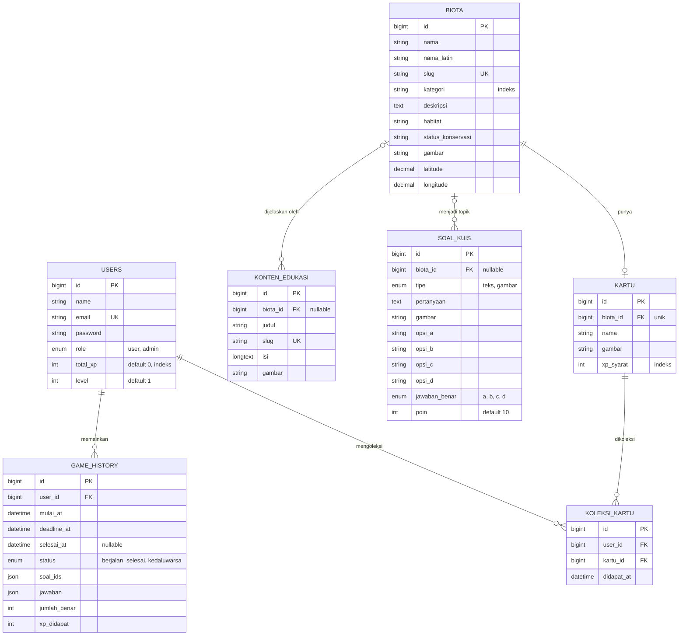
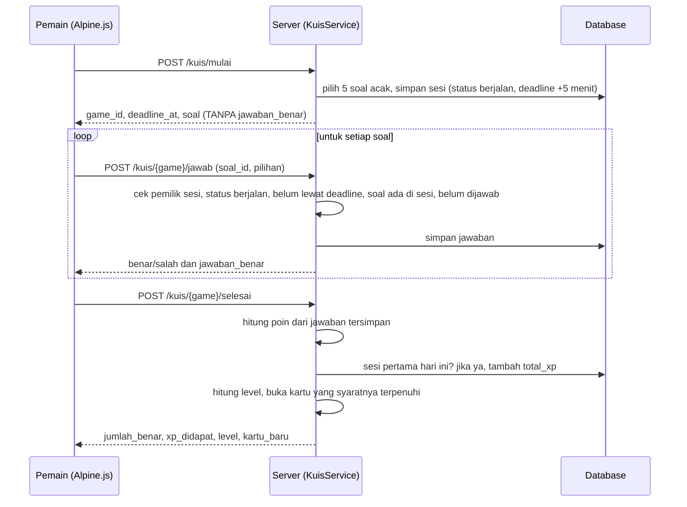

# ERD dan Alur Kuis

## ERD final


Batasan tambahan: `koleksi_kartu` unik pada pasangan (`user_id`, `kartu_id`); `game_history` memiliki indeks gabungan
(`user_id`, `status`, `selesai_at`) untuk pemeriksaan jatah XP harian.

## Alur kuis (integritas di server)


Timer di layar hanya tampilan yang dihitung dari `deadline_at`; keputusan menerima atau menolak jawaban selalu di server.

## Arsitektur lapisan

```
Browser (Blade + Tailwind + Alpine.js, Leaflet)
        |  HTTP (halaman) / JSON (kuis)
Routes -> Middleware (auth, role, throttle) -> Controller (tipis)
        |
Service (KuisService, LevelService, KartuService, GambarService, SlugService)
        |
Model Eloquent  ->  MySQL
```
